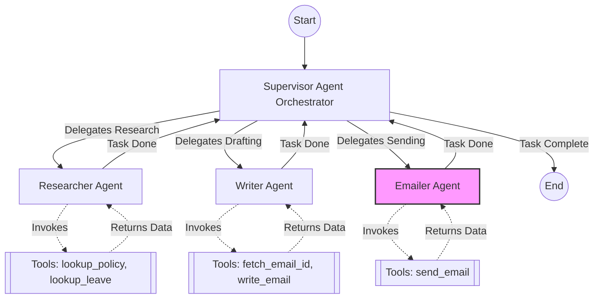

# Enterprise AI Task Supervisor (Multi-Agent System)

## Overview
This project implements a multi-agent system where a complex task is completed by multiple specialized AI agents collaborating under the supervision of a Supervisor agent. Built with LangGraph and Streamlit, it demonstrates the **Orchestrator-Worker pattern**. 

Instead of a single Large Language Model (LLM) attempting to execute a sprawling prompt, the Supervisor divides the task, delegates subtasks to specialist workers with narrowly scoped tools, passes context between them, and manages a Human-in-the-Loop (HITL) interrupt for final approval before dispatching emails.

## System Architecture

The workflow is managed by a LangGraph `StateGraph`. The Supervisor evaluates the conversation state and routes execution to the appropriate worker. Each worker operates in a loop with its specific tools until its subtask is complete, at which point control returns to the Supervisor.

### Agent Workflow Diagram



## Agents and Tools

1. **Supervisor Agent (Orchestrator)**
* **Role:** Analyzes the user request, determines which specialist is needed next, and routes the execution flow.
* **Tools:** None. Operates purely on routing logic and JSON output.


2. **Researcher Agent**
* **Role:** Queries the local knowledge base to retrieve accurate company information. Does not draft or send emails.
* **Tools:**
* `lookup_policy`: Reads the general onboarding guide.
* `lookup_leave`: Reads the company leave policy.


3. **Writer Agent**
* **Role:** Synthesizes the raw data retrieved by the Researcher into a concise email summary. Fetches contact details and saves the draft locally.
* **Tools:**
* `fetch_email_id`: Looks up recipient email addresses from the contacts JSON.
* `write_email`: Saves the generated email text to the local `drafts/` directory.


4. **Emailer Agent**
* **Role:** Dispatches the approved email to the recipient via SMTP.
* **Tools:**
* `send_email`: Connects to an SMTP server (e.g., Gmail) to send the final email. **Note:** Execution pauses for Human-in-the-Loop approval before this tool can run.


## Project Structure

* `app.py`: The Streamlit frontend providing a split-pane UI (Chat History on the left, Live Agent Telemetry on the right) and HITL approval controls.
* `graph.py`: Defines the LangGraph nodes, edges, routing logic, and the MemorySaver checkpointer for state management.
* `agents.py`: Contains the class definitions and narrowly scoped system prompts for the Researcher, Writer, and Emailer agents.
* `tools.py`: Contains the `@tool` decorated Python functions that execute file reading, JSON parsing, file writing, and SMTP connections.
* `config.py`: Initializes the NVIDIA API LLM client and defines global file paths.
* `state.py`: Defines the `AgentState` TypedDict to manage message history across the graph.

## Setup and Installation

**1. Install Dependencies**
Ensure you have Python installed, then install the required packages:

```bash
pip install streamlit langgraph langchain-openai langchain-core python-dotenv

```

**2. Environment Variables**
Create a `.env` file in the root directory and add your credentials:

```env
NVIDIA_API_KEY=your_nvidia_api_key_here
SENDER_EMAIL=your_email@gmail.com
SENDER_PASSWORD=your_16_character_app_password

```

**3. Required Files**
Ensure the following mock data files exist in your project root:

* `company_policy.txt`: Sample company policy text.
* `onboarding_guide.txt`: Sample onboarding instructions.
* `contacts.json`: A dictionary mapping names to emails (e.g., `{"Kunal": "kunal@example.com"}`). **omited for safety**

**4. Run the Application**
Launch the Streamlit dashboard:

```bash
streamlit run app.py

```

## Usage Example

To test the full workflow, enter the following prompt in the chat interface:

> "Research our company's leave policy, prepare a summary, and email it to Kunal."

Watch the Live Telemetry pane to see the Supervisor delegate to the Researcher, then the Writer. The graph will pause and prompt for your approval before allowing the Emailer to dispatch the draft.

